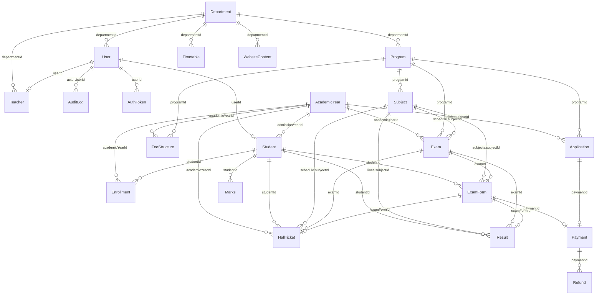

# Database Model Map

All collections live in the MongoDB database configured by `MONGODB_URI`. The API base path is `/api/v1`. Model definitions are under `server/src/models/` and are registered by `server/src/models/index.js`.

Payment configuration uses `PAYMENT_GATEWAY`, `PAYMENT_KEY_ID`, `PAYMENT_KEY_SECRET`, and `PAYMENT_WEBHOOK_SECRET` only. The server reads no other gateway variable names.

## Identity and access

| Model | Purpose | Key relationships |
| --- | --- | --- |
| `User` | Login identity for all roles | `departmentId -> Department` |
| `Role` | Fixed role catalog (`applicant`, `student`, `teacher`, `hod`, `websiteAdmin`, `admissionAdmin`, `examAdmin`, `superAdmin`) | `key` is referenced by `Permission.roleKey` |
| `Permission` | Matrix row: role + resource + action + scope | `roleKey -> Role.key`; unique on `(roleKey, resource, action)` |
| `AuthToken` | Email verification and password reset tokens | `userId -> User`; TTL on `expiresAt` |
| `AuditLog` | Append-only security and workflow audit trail | `actorUserId -> User` |
| `Counter` | Atomic human-readable number sequences | Used for applications, enrollments, receipts, seats |

Scope values are `own`, `department`, and `all`. `requirePermission()` stores the effective scope on `req.permission.scope`.

## Academics

| Model | Purpose | Key relationships |
| --- | --- | --- |
| `Department` | Academic department | `hodUserId -> User` |
| `AcademicYear` | Academic year with one active `current` year | Referenced by most academic records |
| `Program` | Academic program | `departmentId -> Department` |
| `Subject` | Semester subject | `programId -> Program`; unique `(programId, semester, code)` |
| `Teacher` | Teacher profile | `userId -> User`; `departmentId -> Department` |
| `Student` | Student profile and self-service `/students/me` data | `userId -> User`; `programId -> Program`; `admissionYearId -> AcademicYear`; `applicationId -> Application` |
| `Enrollment` | Student subject enrollment; add/drop/promote are exposed through `/students/:id/enrollments` and `/students/:id/promote` | `studentId -> Student`; `subjectId -> Subject`; `academicYearId -> AcademicYear` |
| `Timetable` | Weekly class slot | `academicYearId`, `programId`, `departmentId`, `subjectId`, `teacherUserId` |
| `TeachingPlan` | Teacher topic plan approval workflow | `teacherUserId`, `reviewedByUserId`, `subjectId`, `programId`, `departmentId`, `academicYearId` |
| `Attendance` | Lecture attendance per timetable slot | `slotId -> Timetable`; `subjectId`, `programId`, `departmentId`, `teacherUserId`, `academicYearId` |
| `Marks` | Internal continuous evaluation marks | `studentId`, `subjectId`, `programId`, `departmentId`, `academicYearId`, `enteredByUserId`, `reviewedByUserId` |

## Admissions

| Model | Purpose | Key relationships |
| --- | --- | --- |
| `FeeStructure` | Admission/exam fee heads and totals | `academicYearId -> AcademicYear`; `programId -> Program` |
| `Application` | Full admission application and workflow state | `applicantUserId`, reviewer/user stamps, `academicYearId`, `programId`, `feeStructureId`, `paymentId -> Payment`; NEP subject refs to `Subject` |
| `AdmissionDocument` | Uploaded document with verification state | `applicationId -> Application`; `reviewedByUserId -> User` |

Application statuses are `draft`, `submitted`, `returned`, `waitlisted`, `approved`, `feePaid`, `admitted`, `rejected`, and `cancelled`. Use `application.status` as the source of truth.

## Examinations and results

| Model | Purpose | Key relationships |
| --- | --- | --- |
| `Exam` | Examination session, form window, and paper schedule | `academicYearId -> AcademicYear`; `programId -> Program`; `schedule[].subjectId -> Subject` |
| `ExamForm` | Student exam application and subject choices | `examId -> Exam`; `studentId -> Student`; `feeStructureId -> FeeStructure`; `paymentId -> Payment`; `subjects[].subjectId -> Subject` |
| `HallTicket` | Issued ticket snapshot with seat/room/status | `examId -> Exam`; `examFormId -> ExamForm`; `studentId -> Student`; `programId -> Program`; `academicYearId -> AcademicYear`; `schedule[].subjectId -> Subject` |
| `Result` | Published examination result with CBCS lines and SGPA | `examId -> Exam`; `studentId -> Student`; `examFormId -> ExamForm`; `lines[].subjectId -> Subject` |

Hall tickets snapshot `examName`, `programName`, `enrollmentNumber`, `fullName`, `semester`, and `schedule` at issuance. Later changes to `Exam.schedule` do not rewrite issued tickets.

## Payments

| Model | Purpose | Key relationships |
| --- | --- | --- |
| `Payment` | Gateway order/payment and receipt state | `payerUserId -> User`; `academicYearId`; `feeStructureId`; `applicationId`; `examFormId` |
| `Refund` | Refund request and decision | `paymentId -> Payment`; `requestedByUserId`, `decidedByUserId -> User` |

Payments use `purpose: admission | exam`. Resource-level permissions are derived from purpose (`admissionPayments`/`examPayments`, `admissionRefunds`/`examRefunds`). Gateway configuration uses the `PAYMENT_*` names listed at the top of this document.

## Website content

`WebsiteContent` is implemented, registered in `server/src/models/index.js`, and exposed through the mounted `/website` router.

| Model | Purpose | Key relationships |
| --- | --- | --- |
| `WebsiteContent` | Notices, events, news, gallery items, and pages | `departmentId -> Department`; `authorUserId`, `lastEditedByUserId -> User` |

## Relationship overview

## Important invariants

- One active `AcademicYear` may have `status: current`.
- `server/scripts/data/college-programs.json` contains 60 programs; `server/tests/college-alignment.test.js` enforces that count.
- A student cannot have two active enrollments for the same `(studentId, subjectId, semester)`.
- A student cannot have two exam forms for the same `(examId, studentId)`.
- `Exam.schedule` cannot repeat a subject and must have `endTime > startTime`.
- `HallTicket.seatNumber` is unique per `examId`; seat numbers are allocated as `S-001`, `S-002`, etc.
- A paid `Payment` must have a `receiptNumber`; `Payment.ensureReceipt()` repairs older records.
- A `Refund` cannot be approved by its requester.
- Published results are the only results visible to students through `GET /results`.
- Deleting a student is a deactivation: set `Student.status: withdrawn|graduated` and deactivate the linked `User`.
